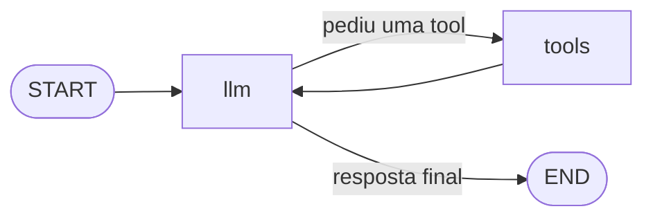

<div align="center">

**Não sabe qual área de tecnologia seguir? O Branchout descobre com você e monta o seu roadmap de estudos, do zero e 100% gratuito.**


</div>

---

O Branchout é um **agente de IA conversacional** (CLI) que age como um guia de carreira:

1. **Conhece você** — experiência, plano de carreira e preferências, numa conversa natural, uma pergunta por vez.
2. **Recomenda a área** que mais combina com o seu perfil e explica o porquê.
3. **Monta um roadmap em fases**, do absoluto zero, usando apenas recursos gratuitos e com links para cada um.
4. **Valida os links** antes de entregar, para você não cair em página fora do ar.

## Como funciona

O agente é um grafo [LangGraph](https://docs.langchain.com/oss/python/langgraph/overview) com o loop clássico de agentes: o modelo decide se precisa de uma tool, a tool roda, e o resultado volta para o modelo.



### Tools

| Tool | O que faz |
| --- | --- |
| `tavily_search` | Busca na web recursos atuais e gratuitos ([Tavily](https://tavily.com)) |
| `save_profile` | Grava o perfil do usuário no state do agente |
| `check_links` | Confere se os links estão no ar antes de o roadmap ser entregue |

### Decisões de design

- **Perfil no state.** A tool `save_profile` grava a experiência, o plano de carreira e as preferências no state do grafo, e o perfil é reinjetado no prompt a cada chamada. O agente não pergunta de novo o que já sabe.
- **Memória por conversa.** Cada conversa é uma `thread_id`, guardada por um checkpointer (`InMemorySaver`).
- **Menos links inventados.** O prompt proíbe criar URLs, exige que os links venham da busca e manda passar todos pelo `check_links` antes de responder.
- **Fluxo explícito.** O grafo é montado à mão (nós, arestas e `ToolNode`), o que dá controle total sobre o fluxo do agente.

## Tecnologias

| | |
| --- | --- |
| Linguagem | Python 3.14 |
| Orquestração | LangGraph e LangChain |
| Modelo | Claude Haiku 4.5, via Amazon Bedrock (Converse API) |
| Busca na web | Tavily |
| Gerenciador de pacotes | uv |

## Como rodar

**Pré-requisitos:** Python 3.14+, [uv](https://docs.astral.sh/uv/), acesso ao Claude no Amazon Bedrock e uma chave gratuita do [Tavily](https://tavily.com).

```bash
git clone https://github.com/tcunha2004/branchout.git
cd branchout

cp .env.example .env     # preencha as chaves
uv sync
uv run branchout
```

Variáveis de ambiente (`.env`):

| Variável | Para quê |
| --- | --- |
| `AWS_BEARER_TOKEN_BEDROCK` | Chave de API do Amazon Bedrock |
| `AWS_REGION` | Região do Bedrock |
| `TAVILY_API_KEY` | Chave da busca Tavily |

Para encerrar a conversa, digite `sair`.

## Estrutura do projeto

```text
src/branchout/
├── main.py            # CLI: boas-vindas e loop da conversa
├── agent/
│   └── agent.py       # prompt, modelo, state e grafo LangGraph
└── tools/
    └── tools.py       # save_profile e check_links
```

## Limitações conhecidas

- **A memória vive na RAM.** O `InMemorySaver` se perde ao fechar o programa.
- **Um usuário por execução.** A conversa usa uma `thread_id` fixa.
- **`check_links` não é infalível.** Alguns sites bloqueiam robôs (403/429) e o YouTube pode responder 200 mesmo para vídeo indisponível.
- **Ainda não há testes automatizados** nem avaliação da qualidade das recomendações.

## Ideias para as próximas versões

- Persistência com SQLite ou Postgres, para retomar a conversa depois.
- Interface web.
- Avaliação (evals) das recomendações e dos roadmaps gerados.

## Autor

Feito por [@tcunha2004](https://github.com/tcunha2004).
